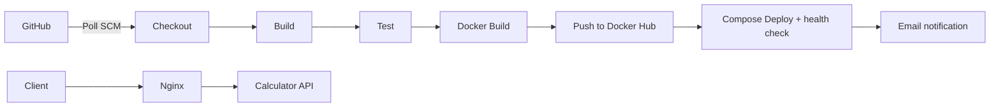

# Calculator DevOps

A Spring Boot calculator REST API with a Jenkins CI/CD pipeline that builds, tests, containerises, publishes and deploys it with Docker Compose.

CSE 816 Software Production Engineering mini-project, Term I 2026-27.
**Author:** Digvijaysinh Pawar (IMT2023099)

| | |
| --- | --- |
| Report | [docs/project-report.pdf](docs/project-report.pdf) |
| Docker Hub | [imnotfound/calculator-devops](https://hub.docker.com/r/imnotfound/calculator-devops) (tags = Jenkins build numbers) |
| Screenshots | [docs/screenshots/](docs/screenshots/) |

## Pipeline



A push to `main` is picked up by Jenkins (Poll SCM, every 2 minutes), which runs the stages in the [`Jenkinsfile`](Jenkinsfile):

| Stage | What it does |
| --- | --- |
| Checkout | `checkout scm` |
| Build | `mvn clean package -DskipTests` |
| Test | `mvn test`, publishes `target/surefire-reports/TEST-*.xml`; a failing test stops the pipeline |
| Docker Build | builds `imnotfound/calculator-devops:<BUILD_NUMBER>` |
| Push | logs in with the Jenkins `dockerhub` credential and pushes the image |
| Deploy | `docker compose up -d --no-build --wait`, then checks `/actuator/health` through Nginx |
| Post | emails the build result; prints Compose logs on failure |

## Prerequisites

- JDK 17 and Maven 3.6.3+ (`mvn -version` must report Java 17; Maven follows `JAVA_HOME`)
- Docker Engine with Docker Compose v2
- Jenkins (only for the pipeline)

## Build, test and run

```bash
mvn clean package
mvn test
java -jar target/calculator.jar --server.port=8081
```

There are 31 JUnit 5 tests: unit tests for `CalculatorService` and MockMvc integration tests for the REST endpoints and the health endpoint.

## API

| Operation | Request |
| --- | --- |
| Add | `GET /api/v1/add?a=2&b=3` |
| Subtract | `GET /api/v1/subtract?a=2&b=3` |
| Multiply | `GET /api/v1/multiply?a=2&b=3` |
| Divide | `GET /api/v1/divide?a=2&b=3` |
| Health | `GET /actuator/health` |

```bash
curl 'http://localhost:8081/api/v1/add?a=2&b=3'
# {"operation":"add","a":2.0,"b":3.0,"result":5.0}

curl 'http://localhost:8081/api/v1/divide?a=1&b=0'
# HTTP 400
# {"type":"about:blank","title":"Bad Request","status":400,"detail":"Division by zero is not allowed.","instance":"/api/v1/divide"}
```

Missing, empty, non-numeric or non-finite parameters, division by zero, and results that overflow also return HTTP 400 with a problem-detail body. Unknown operations return 404. Calculations use Java `double`.

## Docker

```bash
docker build -t calculator-devops:local .
docker run --rm -p 127.0.0.1:8081:8080 calculator-devops:local
```

The Dockerfile is multi-stage: a Maven/JDK stage builds the JAR (dependencies cached in their own layer), and a JRE stage runs it as the non-root `calculator` user. `.dockerignore` limits the build context to `pom.xml` and `src/`.

## Docker Compose

```bash
docker compose up -d --build --wait
curl 'http://localhost:8081/actuator/health'
docker compose ps
docker compose down
```

Compose starts the API and an Nginx reverse proxy on a private network, both with health checks and `restart: unless-stopped`. Nginx starts once the API is healthy and is the only service published on the host (`127.0.0.1:8081`; set `APP_PORT` to change the port).

To deploy an image already published by Jenkins:

```bash
CALCULATOR_IMAGE=imnotfound/calculator-devops:<build-number> docker compose up -d --no-build --wait
```

## Jenkins setup

1. Install the plugins Pipeline, Git, JUnit, Credentials Binding, Email Extension and Timestamper.
2. Under *Tools*, add a JDK named `JDK17` and a Maven installation named `Maven3`. The agent also needs Git, the Docker CLI and Docker Compose v2.
3. Add credentials (*Username with password*):
   - `dockerhub`: Docker Hub username and an access token with push permission
   - `calculator-smtp`: Gmail address and a Gmail app password
4. Under *Extended E-mail Notification*, set SMTP host `smtp.gmail.com`, port 587, TLS, and the `calculator-smtp` credential.
5. Create a Pipeline job `calculator-devops`: *Pipeline script from SCM*, repository `https://github.com/ImNotFound7/calculator-devops.git`, branch `*/main`, script path `Jenkinsfile`.
6. Run the job once to register the Poll SCM trigger. Later pushes to `main` start builds automatically.

No credentials are stored in this repository; they live only in the Jenkins credentials store.
