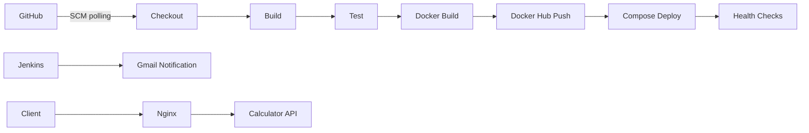

# Calculator DevOps

CSE 816 Software Production Engineering mini-project: a Java calculator REST API with an automated Jenkins pipeline and Docker Compose deployment.

The assignment requirements are in [SPE_Mini_Project.docx](SPE_Mini_Project.docx).

## Project scope

The assignment requires Spring Boot and Maven, four arithmetic endpoints, structured input validation, JUnit 5 tests, and an Actuator health endpoint. The Jenkins pipeline must check out, build, test, containerize, push to Docker Hub, deploy with Compose, verify health, and send build notifications.

Deployment must include the calculator and a second component, such as an Nginx reverse proxy. Submission includes a short PDF report, screenshots, and a live demonstration of automatic deployment after a GitHub push.

## Prerequisites

- JDK 17 and Maven 3.6.3 or newer for the application.
- Git and a GitHub repository for version control.
- Docker Engine and Docker Compose for container deployment.
- Jenkins with Java 17, Maven, Docker access, GitHub access, Docker Hub credentials, and email delivery configured.

Maven uses `JAVA_HOME`. Ensure `mvn -version` reports Java 17 or newer, even if `java -version` already does.

## Build and test

Set `JAVA_HOME` to your JDK 17 installation, then run:

```bash
mvn clean package
mvn test
java -jar target/calculator.jar --server.port=8081
```

The JUnit 5 unit and Spring MVC integration tests cover all operations, validation, division by zero, and health. Jenkins can publish the XML reports from `target/surefire-reports/TEST-*.xml`.

## API

| Operation | Request |
| --- | --- |
| Add | `GET /api/v1/add?a=2&b=3` |
| Subtract | `GET /api/v1/subtract?a=2&b=3` |
| Multiply | `GET /api/v1/multiply?a=2&b=3` |
| Divide | `GET /api/v1/divide?a=2&b=3` |
| Health | `GET /actuator/health` |

```bash
curl 'http://localhost:8081/api/v1/add?a=2&b=3'
curl 'http://localhost:8081/api/v1/divide?a=1&b=0'
curl 'http://localhost:8081/actuator/health'
```

Successful calculations return JSON:

```json
{"operation":"add","a":2.0,"b":3.0,"result":5.0}
```

Missing, empty, non-numeric, and non-finite parameters, division by zero, and numeric overflow return HTTP 400 with a problem-detail JSON body:

```json
{"type":"about:blank","title":"Bad Request","status":400,"detail":"Division by zero is not allowed.","instance":"/api/v1/divide"}
```

Calculations use Java `double` arithmetic. Decimal results follow floating-point precision, so values such as `0.1 + 0.2` may have small rounding differences. Unknown operations return HTTP 404.

## Docker and Compose

```bash
docker compose up -d --build --wait
curl 'http://localhost:8081/api/v1/add?a=2&b=3'
docker compose ps
docker compose logs
docker compose down
```

Compose starts the API and an Nginx reverse proxy on a dedicated network. Both services have health checks and restart policies. Nginx waits for the API to become healthy. Only the proxy is published, at `127.0.0.1:8081`; set `APP_PORT` to choose another host port.

The Dockerfile caches Maven dependencies in a build stage and copies only the executable JAR into a JRE runtime stage. The API runs as the `calculator` user. `.dockerignore` restricts the build context to the Maven file and application sources.

To run the image without Compose:

```bash
docker build -t calculator-devops:local .
docker run --rm -p 127.0.0.1:8081:8080 calculator-devops:local
```

To deploy a published build instead of building locally:

```bash
export CALCULATOR_IMAGE=imnotfound/calculator-devops:BUILD_NUMBER
docker compose pull
docker compose up -d --no-build --wait --wait-timeout 120
```

Replace `BUILD_NUMBER` with an existing Jenkins build tag. Rerunning `up` keeps the existing deployment when its configuration and image have not changed. Updating the image replaces the API container; Nginx refreshes Docker DNS so it can reach the replacement.

## Jenkins



The checked-in declarative `Jenkinsfile` defines Checkout, Build, Test, Docker Build, Push, and Deploy stages. Build runs `mvn clean package -DskipTests`; Test runs `mvn test` and always publishes JUnit XML reports. A test failure prevents image publication and deployment.

Images are tagged `imnotfound/calculator-devops:<Jenkins build number>`. Deployment waits for both containers to become healthy and probes health through the proxy. Concurrent runs are queued to protect the shared Compose deployment. The pipeline sends its final status by email on success or failure.

Configure Jenkins as follows:

1. Install Pipeline, Git, JUnit, Credentials Binding, Email Extension, and Timestamper plugins.
2. Register tools named `JDK17` and `Maven3` pointing to JDK 17 and Maven installations. The agent must have Git, the Docker CLI, Docker Compose v2 with `--wait` support, and access to the deployment Docker daemon. The supplied pipeline also searches the common Homebrew and Docker Desktop CLI directories on macOS.
3. Add a **Username with password** credential with ID `dockerhub`: Docker Hub username `imnotfound` and a Docker Hub access token with image push permissions.
4. Add a **Username with password** credential with ID `calculator-smtp`: username `digvijaysinhsp149@gmail.com` and a Gmail app password. In Extended E-mail Notification, set host `smtp.gmail.com`, port `587`, TLS enabled, this credential, and sender address `digvijaysinhsp149@gmail.com`. Notifications go to the same Gmail address.
5. Create a Pipeline job named `calculator-devops`. Select **Pipeline script from SCM**, Git, repository `https://github.com/ImNotFound7/calculator-devops.git`, branch `*/main`, and script path `Jenkinsfile`. The public repository needs no checkout credential. If using a private copy, configure GitHub read access through the Jenkins user's Git credential helper or a Jenkins-managed credential selected in the SCM settings.
6. Run the job once to register its polling trigger. Subsequent GitHub changes are detected automatically every two minutes using Poll SCM, which the assignment permits. Keep Jenkins and Docker running for the live demo.

The deployment runs on the same Docker daemon used by the Jenkins agent. With Docker Desktop, allow sharing of the Jenkins workspace directory so the Nginx configuration can be mounted. On a remote daemon, that directory must exist on the daemon host too.

Credentials stay in Jenkins, outside the repository. Image push uses a temporary Docker authentication directory and removes it afterward.

